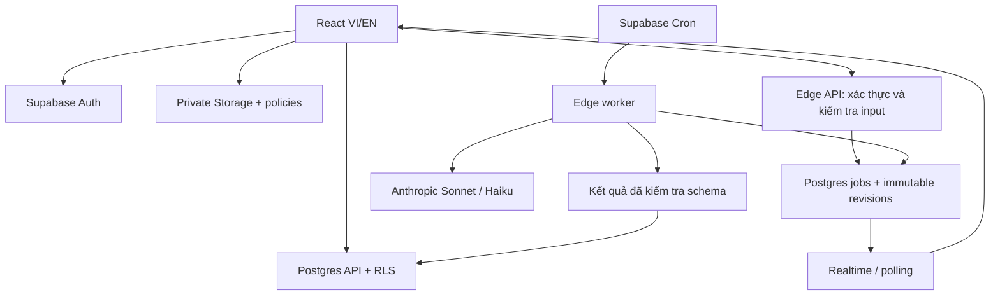

# IELTS — Thiết kế full-stack

Ngày: 2026-10-24. Trạng thái: phạm vi đã duyệt; bản thiết kế chi tiết chờ duyệt trước triển khai.

## 1. Sản phẩm và phạm vi

Ứng dụng luyện IELTS Writing miễn phí, giao diện VI/EN, tên hiển thị **IELTS**. Viết mới frontend và backend. Các dữ liệu từng suy luận từ bundle CrackWriting chỉ là tham khảo nghiệp vụ, không phải schema đã xác minh để sao chép.

### Phạm vi đã thống nhất

- Task 2: viết tự do hoặc luyện theo target band.
- Task 1 Academic: line, bar, pie, table, process, map, mixed; nhập dữ liệu/mô tả hoặc tải ảnh.
- Task 1 General Training: thư formal, semi-formal, informal.
- Điểm theo tiêu chí, feedback, lịch sử, phân tích cấu trúc.
- Error Logbook và ôn lỗi theo lịch.
- Kho từ vựng, lưu từ/collocation/cấu trúc câu cần nhớ, ôn tập.
- Thư viện khung bài, bài mẫu, Master Guide gồm tài liệu nền tảng và gợi ý cá nhân hóa.
- Magic Rewrite, Argument Stress Test, Critical Thinking.
- Donate tự nguyện và trang quản trị.
- Không quota bài/ngày hoặc credit; giới hạn tốc độ và số request đồng thời để chống spam.

Ngoài phạm vi: affiliate, coaching, forum, leaderboard, workbook, peer review, pressure chamber, hardcore, subscription, premium, B2B API. Donate không mở khóa quyền lợi.

### Nguyên tắc chất lượng

- Điểm AI là ước lượng luyện tập; giao diện không mô tả là điểm thi được chứng nhận.
- Target band chỉ điều chỉnh lời khuyên, không làm thay đổi tiêu chuẩn chấm.
- Không thay lỗi AI bằng điểm mặc định, điểm ngẫu nhiên hoặc heuristic giả chấm thi.
- Bài viết, ảnh đề, bộ từ cá nhân mặc định riêng tư.
- Nội dung mẫu và hướng dẫn được biên soạn mới; có nguồn và trạng thái duyệt.

## 2. Kiến trúc

### Lựa chọn

| Hướng | Đánh đổi | Quyết định |
|---|---|---|
| React SPA + Supabase + Anthropic trực tiếp | Ít dịch vụ, RLS tại DB; cần xử lý giới hạn thời gian Edge Functions | Chọn, khớp stack đã duyệt |
| Next.js full-stack + Postgres | Thuận tiện SSR cho thư viện công khai; thêm server runtime | Không cần cho bản này |
| API/worker riêng trên VPS | Tự chủ tác vụ dài; tăng vận hành | Chỉ chuyển worker khi số đo thời gian yêu cầu |

Frontend: React 19, TypeScript, Vite, Tailwind CSS v4, shadcn/ui. React Router cho điều hướng, TanStack Query cho dữ liệu server, react-i18next cho bản dịch. Không thêm Redux, trình soạn thảo rich text hoặc engine animation khi chưa cần.

Backend: Supabase Auth, PostgreSQL, Storage riêng tư, Edge Functions. Postgres lưu hàng đợi job; Supabase Cron gọi worker. Realtime chỉ phát trạng thái job của chủ sở hữu; polling là fallback.

AI: Anthropic Messages API gọi từ backend. Model chấm `claude-sonnet-4-6`; model phụ trợ `claude-haiku-4-5-20251001`. Tên model nằm trong server secrets/config, không do client truyền tùy ý. Kiểm tra quyền truy cập model bằng tài khoản thật trước phát hành.

Không dựng router nhiều provider ở v1. Một module server nhỏ gọi Anthropic; việc đổi provider sau này không ảnh hưởng hợp đồng kết quả nội bộ.

## 3. Frontend: cấu trúc màn hình

### Điều hướng

Desktop: sidebar 248px; header chứa tên trang, VI/EN, tài khoản. Nhóm menu: Tổng quan; Viết bài; Lịch sử; Học tập; Thư viện; Master Guide. Donate ở cuối sidebar; Admin chỉ hiện với quyền hợp lệ.

Mobile: thanh dưới 4 mục Tổng quan, Viết bài, Ôn tập, Thư viện; mục còn lại trong menu tài khoản. Không ép sidebar desktop xuống màn hình hẹp.

| Route | Nội dung và hành động chính |
|---|---|
| `/` | Giới thiệu, chọn Task 1/2, bản minh họa feedback có nhãn minh họa, giải thích miễn phí, CTA bắt đầu |
| `/auth` | Đăng ký/đăng nhập email + mật khẩu, xác minh email, quên mật khẩu |
| `/auth/callback`, `/auth/reset-password` | Hoàn tất xác thực và đặt lại mật khẩu |
| `/app` | Bài gần đây, bắt đầu viết, số thẻ đến hạn, xu hướng điểm theo từng loại task |
| `/app/write` | Chọn loại bài; nhập đề, ảnh/dữ liệu; viết; lưu nháp; gửi chấm |
| `/app/essays` | Tìm kiếm, lọc task/ngày/trạng thái, tiếp tục nháp, xem kết quả, xóa |
| `/app/essays/:id` | Nháp hoặc lần nộp gần nhất; chọn phiên bản, xem tiến trình/kết quả |
| `/app/errors` | Lỗi cá nhân theo tiêu chí, ví dụ gốc, cách sửa, lưu để ôn |
| `/app/vocabulary` | Từ/cụm từ/cấu trúc đã lưu, tìm kiếm, tag, thêm thủ công |
| `/app/review` | Phiên ôn thẻ đến hạn; hiện đáp án, Nhớ/Chưa nhớ, tiến độ |
| `/library` | Các tab Đề bài, Từ vựng, Khung bài, Bài mẫu; tìm kiếm và lọc |
| `/library/:kind/:slug` | Đọc nội dung, lưu từ/cấu trúc, dùng đề/khung để viết bài |
| `/guide`, `/guide/:slug` | Master Guide, mục lục, bài học, phần Gợi ý cho bạn khi đăng nhập |
| `/app/tools` | Rewrite, Stress Test, Critical Thinking; chọn bài/đoạn để chạy |
| `/donate` | QR và thông tin chuyển khoản do admin cấu hình; sao chép tài khoản |
| `/app/settings` | Tên, ngôn ngữ UI/feedback, mục tiêu, múi giờ, xóa tài khoản |
| `/admin` | Nội dung, đề bài, người dùng, job lỗi, token AI, donate; tab con có deep link |

### 3.1 Không gian viết

Desktop chia hai cột: đề bài 38%, bài viết 62%. Header giữ loại task, trạng thái lưu; footer của editor có số từ, thời gian tùy chọn, nút Chấm bài. Mobile chuyển tab Đề bài/Bài viết, không dùng hai cột thu nhỏ.

- Chọn `task2`, `academic_task1`, `general_task1` trước khi nhập.
- Academic: chọn subtype; nhập đề và dữ liệu có nhãn/đơn vị, hoặc tải tối đa 2 ảnh JPEG/PNG/WebP, mỗi ảnh tối đa 5 MiB. Process/map dùng mô tả bước/vị trí, không ép thành bảng số.
- Khi đọc ảnh bằng Haiku: hiện dữ liệu trích xuất bên cạnh ảnh để người dùng xác nhận/sửa. Phần không đọc được được đánh dấu, không tự bịa giá trị.
- Có thể nhập ảnh và dữ liệu bổ sung cùng lúc; backend giữ cả hai nguồn. Sonnet nhận ảnh gốc khi chấm bài có ảnh.
- General: đề thư, người nhận, tone, các bullet cần trả lời.
- Editor dùng textarea với font đọc rõ, không tự đổi dấu câu. Đếm từ thống nhất frontend/backend theo quy tắc versioned.
- Task 1 dưới 150 từ, Task 2 dưới 250 từ: cảnh báo nhưng vẫn cho chấm bài chưa đủ dài; không trừ band bằng công thức cố định.
- Input cap: bài 30.000 ký tự, đề 6.000 ký tự, dữ liệu tham chiếu 20.000 ký tự. Lỗi hiện cạnh trường.
- Lưu nháp sau 1 giây ngừng gõ; bản phục hồi trong IndexedDB theo user và essay. Xóa bản local khi đăng xuất. Nếu mất mạng, hiển thị rõ chưa đồng bộ.
- Đồng bộ có số `draft_version`; xung đột giữa hai tab yêu cầu chọn bản, không ghi đè im lặng.
- Gửi chấm tạo snapshot bất biến. Sửa bài sau đó tạo lần nộp khác; không sửa nội dung của kết quả cũ.

### 3.2 Kết quả chấm

Header: band ước lượng, loại bài, ngày chấm, model. Bốn thẻ tiêu chí TA/TR, CC, LR, GRA. Chưa có điểm thì hiện trạng thái, không hiện `0.0`.

Nội dung gồm: Tổng quan; Sửa chi tiết; Cấu trúc; Từ vựng; Kế hoạch cải thiện. Desktop đặt bài và feedback cạnh nhau; mobile xem từng tab. Mỗi nhận xét có trích dẫn nguyên văn, giải thích VI/EN theo lựa chọn lúc nộp, cách sửa bằng tiếng Anh.

Highlight liên kết với đoạn gốc và dùng được bằng bàn phím. Nếu không khớp trích dẫn, hiển thị nhận xét độc lập thay vì tô sai vị trí. Nút lưu từ/cấu trúc, thêm lỗi vào ôn tập, viết lại đoạn, sửa và chấm lại có trạng thái rõ ràng.

### 3.3 Từ vựng, cấu trúc và ôn tập

- Kho công khai do admin biên soạn: từ/collocation, nghĩa VI/EN, ví dụ, chủ đề, ghi chú dùng từ.
- Bộ nhớ riêng: lưu từ kho, chọn từ feedback/bài mẫu hoặc nhập tay. Bản lưu là snapshot để nguồn thay đổi không mất nội dung đã học.
- Cấu trúc câu được lưu như thẻ riêng loại `structure`; khung toàn bài nằm trong Thư viện khung bài.
- Phiên ôn: mặt trước là từ/câu có chỗ trống; mặt sau nghĩa, ví dụ và giải thích. Không tính thời gian bắt buộc.
- Lịch nhớ: lần nhớ đầu 1 ngày, tiếp theo 3, 7, 14, 30, 60 ngày; nhớ tiếp giữ chu kỳ 60 ngày. Chưa nhớ đặt lại mức 0 và hẹn 1 ngày.
- Backend cập nhật lịch và lưu sự kiện trong một transaction; request lặp không cộng hai lần.

### 3.4 Thư viện và Master Guide

- Khung bài theo loại task; có mục đích từng đoạn, biến thể, ví dụ. Phân tích không phạt bài tốt chỉ vì khác template.
- Bài mẫu có đề đi kèm, loại task, band mục tiêu/ước lượng, đoạn chú thích và nguồn. Không gắn nhãn điểm giám khảo nếu chưa có bằng chứng.
- Master Guide gồm: rubric, Task 2, Academic Task 1, thư General, coherence, grammar, vocabulary, tự sửa bài, lộ trình luyện.
- Nội dung nền tảng dùng Markdown đã lọc HTML; có bản VI/EN và bản nháp/xuất bản.
- Cá nhân hóa dựa trên tối đa 10 kết quả gần nhất trong 60 ngày, tách từng loại task. Chọn tiêu chí yếu và lỗi lặp bằng truy vấn DB, ghép `skill_tags` với bài hướng dẫn/bài tập; không gọi AI mỗi lần mở trang.
- Có dưới 3 bài: hiện gợi ý nhập môn, không kết luận xu hướng. Luôn hiển thị số bài và khoảng thời gian làm căn cứ.
- Bài tập ngắn dạng chọn đáp án hoặc tự sửa rồi xem lời giải; dùng trong Guide, không dựng module Workbook.

### 3.5 Admin và donate

Admin soạn nội dung song ngữ, preview, xuất bản/ẩn; quản lý prompt, bài mẫu, khung bài, guide, từ vựng, bài tập. Xem trạng thái tài khoản, khóa/mở truy cập app và xem job lỗi/usage. Không mở quyền đọc bài riêng tư hàng loạt chỉ vì là admin.

Donate hiển thị phương thức đã cấu hình: ngân hàng, MoMo, ZaloPay. Có tên người nhận, tài khoản/link hợp lệ, ảnh QR và ghi chú. Không tự xác nhận đã nhận tiền; không tạo subscription hay ledger thanh toán. Chưa cấu hình thì trang hiện thông báo rõ ràng.

## 4. Design system và song ngữ

Nguồn quy tắc chi tiết: `design-system/ielts/MASTER.md`. Áp dụng UI UX Pro Max: Minimalism & Swiss, grid rõ, tương phản, bàn phím, responsive. Bento dùng ở tổng quan/landing; editor và feedback ưu tiên đọc.

- Màu chủ đạo giữ Teal `#0D9488`, accent Amber `#D97706`; CTA dùng biến thể đủ tương phản.
- Outfit cho heading tiếng Anh; Work Sans hỗ trợ tiếng Việt cho UI/body và heading tiếng Việt. Có system fallback.
- Spacing bội 4/8, card bo 12px, shadow nhẹ, chuyển trạng thái 150–200ms; hỗ trợ reduced motion.
- UI VI mặc định, lưu lựa chọn vào profile và local preference trước đăng nhập. `html.lang` cập nhật theo locale.
- UI locale và feedback locale tách riêng. Đổi UI không gọi AI hoặc dịch lại kết quả cũ.
- Tiếng Anh giữ nguyên cho đề, bài viết, câu sửa. Nội dung biên tập có hai bản dịch; thiếu bản dịch hiển thị nhãn dùng bản gốc.
- Format ngày/số qua `Intl`; DB lưu UTC, lịch ôn tính theo thời điểm thực và hiển thị múi giờ profile.
- Mọi màn hình có loading, empty, error, retry và unauthorized phù hợp; không dùng spinner vô hạn.

## 5. Thiết kế dữ liệu

Đây là schema mới dự kiến triển khai qua migrations, không phải DDL của website tham khảo. UUID cho khóa nghiệp vụ; `timestamptz` cho thời gian; `jsonb` chỉ dùng cho cấu trúc biến đổi đã được kiểm tra schema.

### 5.1 Tài khoản, bài viết và AI

| Bảng | Trường chính và ràng buộc |
|---|---|
| `profiles` | `id` FK `auth.users`, `display_name`, `ui_locale`, `feedback_locale`, `timezone`, `target_band`; chỉ dữ liệu user được sửa |
| `user_access` | `user_id` unique FK, `role` user/admin, `status` active/suspended; chỉ server sửa |
| `writing_prompts` | `id`, `task_type`, `subtype`, `prompt_text`, `reference_data`, `status`, `created_by`; đề tiếng Anh |
| `essays` | `id`, `user_id`, `prompt_id` nullable, `title`, `draft` JSON đã validate, `draft_version`, timestamps |
| `essay_revisions` | `id`, `essay_id`, `user_id`, `revision_no`, `task_type`, `subtype`, `prompt_text`, `essay_text`, `reference_data`, `feedback_locale`, `target_band`, `input_hash`, `word_count`; unique `(essay_id,revision_no)`; server tạo, bất biến |
| `essay_assets` | `id`, `user_id`, `essay_id`, `object_path` unique, MIME/size/hash do server xác minh, `status`; object không được ghi đè |
| `revision_assets` | `(revision_id,asset_id)` PK, giữ tập ảnh chính xác cho từng lần nộp |
| `ai_jobs` | `id`, `user_id`, `revision_id` nullable, `operation`, `payload`, `idempotency_key`, `cache_key`, `status`, `attempts`, `lease_token`, `lease_until`, `next_attempt_at`, `result_id`, `error_code`; unique `(user_id,idempotency_key)` |
| `grading_results` | `id`, `revision_id` unique, bốn điểm tiêu chí, `overall_raw`, `overall_display`, feedback JSON, `model`, `prompt_version`, `rubric_version`, `schema_version`, timestamps |
| `essay_features` | `revision_id` unique FK, `model`, structure/lexical/grammar JSON, `schema_version`; có thể xuất hiện sau điểm chính |
| `ai_tool_results` | `id`, `job_id` unique, `user_id`, `operation`, kết quả JSON có schema riêng; vision/rewrite/stress-test/critical-thinking |
| `ai_usage` | `id`, `job_id` nullable, provider request ID, model, input/output/cache tokens, `estimated_cost_usd` nullable, `pricing_version`, latency/status; chỉ backend ghi |

Các quan hệ mang `user_id` dùng composite FK với khóa `(id,user_id)` của bảng cha để ngăn gắn con vào bài người khác. Quan hệ revision/asset phải cùng owner và cùng essay. Điểm số có CHECK 0–9, bước 0.5; trạng thái/locale/task dùng CHECK tường minh.

### 5.2 Học tập và nội dung

| Bảng | Trường chính và ràng buộc |
|---|---|
| `error_logs` | `id`, `user_id`, `revision_id`, `fingerprint`, criterion/category, quote/correction/explanation, `skill_tags`; unique `(revision_id,fingerprint)` |
| `study_cards` | `id`, `user_id`, kind vocabulary/collocation/structure/error, front/back/example, tags, source refs nullable, `dedupe_key`, `level`, `due_at`; unique `(user_id,dedupe_key)` |
| `review_events` | `id`, `user_id`, `card_id`, remembered boolean, reviewed_at, level trước/sau, `request_id`; unique `(user_id,request_id)` |
| `content_entries` | `id`, kind vocabulary/template/sample/guide/exercise, `slug`, `task_type` nullable, `skill_tags`, `sort_order`, `status`, `prompt_id` nullable, `metadata` theo kind; unique `(kind,slug)` |
| `content_translations` | `(entry_id,locale)` PK, title/summary/body Markdown; locale vi/en; bài mẫu giữ nguyên bài tiếng Anh trong metadata |
| `guide_progress` | `(user_id,entry_id)` PK, completed_at; owner ghi qua RPC kiểm tra nội dung guide |
| `donation_settings` | Singleton cấu hình công khai đã validate: phương thức, tên người nhận, QR path, HTTPS link, hướng dẫn VI/EN |
| `admin_audit_logs` | Actor, action, target, timestamp, metadata tối thiểu; server ghi, không chứa toàn bài hoặc secret |
| `rate_limit_buckets` | Khóa user/IP đã hash, operation, time window, counter; schema private, hết hạn tự dọn |

Metadata theo kind: template chứa task/subtype và block outline; sample chứa essay text và provenance điểm; vocabulary chứa expression/example; guide chứa chương và prerequisites; exercise chứa câu hỏi/đáp án/lời giải. Validate khi ghi, không dùng JSON tùy ý thay cho quan hệ.

### 5.3 Index và vòng đời

- Index theo `user_id, updated_at` trên essays; `user_id, due_at` trên study_cards; `user_id, created_at` trên errors/results qua revision.
- Partial index hàng đợi trên `(next_attempt_at,created_at)` cho queued/retry và `(lease_until)` cho processing.
- Index mọi FK dùng để join hoặc kiểm tra RLS. Nội dung dùng `kind,status,slug`; tìm kiếm Postgres full-text `simple` với normalization dấu cho VI, không dựng vector DB.
- Xóa essay qua server: đánh dấu deleting, hủy job, xóa Storage bằng Storage API, rồi xóa DB trong quy trình có thể retry. Worker kiểm tra tombstone trước ghi kết quả.
- Xóa bài kéo theo revisions/results/features/error_logs; study_cards đã lưu giữ snapshot, source ref chuyển null. Xóa tài khoản xóa cả thẻ và lịch ôn.
- Usage không giữ văn bản bài; giữ số liệu vận hành 90 ngày, tách khỏi user/job khi xóa để chỉ còn số liệu không định danh. Upload dang dở dọn sau 24 giờ; object đã gắn revision không bị dọn theo tuổi upload.

## 6. RLS và quyền truy cập

RLS bật trên mọi bảng trong schema public. Kết hợp quyền SQL và policies; route guard frontend chỉ là UX.

| Nhóm | Đọc | Ghi |
|---|---|---|
| `profiles` | Chủ tài khoản | Chủ tài khoản, whitelist cột; không có role trong bảng này |
| `user_access` | User đọc quyền chính mình | Chỉ server; cấp admin lần đầu qua thao tác quản trị tin cậy |
| `essays` | Owner active | Owner sửa nháp qua RPC kiểm tra version; xóa qua Edge API |
| Revisions/assets/jobs/results/features/tool results | Owner active qua quan hệ được kiểm tra | Chỉ server; client không sửa điểm, owner, trạng thái job |
| `error_logs` | Owner active | Server tạo; owner xóa qua RPC |
| `study_cards`, `review_events` | Owner active | CRUD thẻ qua RPC; lịch ôn và review_events chỉ `review-card` cập nhật |
| Content/prompts/translations | Anonymous chỉ published; admin xem nháp | Admin qua API, backend kiểm tra quyền trong DB |
| `guide_progress` | Owner | Owner qua RPC |
| Donate | Mọi người đọc phần công khai | Admin qua API |
| Usage/audit | Admin qua view/API đã lọc | Chỉ server |
| Rate buckets/lease internals | Không cấp client | Chỉ server |

Policy owner sử dụng `auth.uid() = user_id` và kiểm tra active; INSERT/UPDATE có `WITH CHECK`. Không tin `user_id` client gửi. Quyền admin không lấy từ email, localStorage hoặc `user_metadata` tự sửa được.

Helper đọc quyền đặt trong schema private; SECURITY DEFINER có `search_path` cố định, tham chiếu schema đầy đủ, revoke EXECUTE mặc định và chỉ grant đúng vai trò cần. Kiểm tra role khi thực hiện thao tác nhạy cảm, không phụ thuộc JWT role cũ sau khi thu hồi.

Service-role bypass RLS: mọi Edge Function dùng quyền này phải kiểm tra JWT, owner, active và quan hệ đầu vào trước truy vấn. Worker chỉ nhận job ID đã được server tạo; không thực thi payload SQL/URL từ model.

Storage:

- `essay-images` private: đường dẫn `user_id/essay_id/asset_id.ext`; cấp upload theo owner và record pending. Không cho overwrite; server kiểm tra magic bytes, MIME, kích thước và liên kết trước chấm.
- Xem ảnh bằng URL ký ngắn hạn sau kiểm tra owner. Không ghi URL ký vào DB/cache; worker tải ảnh từ object đã xác minh.
- `content-media` private: admin upload; server chỉ cấp URL cho media của nội dung published, hoặc admin đang preview. Tránh lộ ảnh trong bài nháp.
- `donation-media` public: chỉ admin upload; chỉ chứa QR dành cho công khai.

## 7. Hợp đồng backend

Client đọc dữ liệu qua Supabase API + RLS. Hành động có transaction hoặc quyền cao dùng RPC/Edge Functions. Request ID dùng UUID; lỗi có `{code,message,requestId,retryAfter?}`; không trả stack trace/provider secret.

| Hành động | Input | Kết quả / quy tắc |
|---|---|---|
| `save-draft` RPC | essay ID nullable, expected version, draft | Essay ID + version; conflict trả mã riêng, không ghi đè |
| `prepare-upload` Edge | essay ID, MIME, size | asset ID và quyền upload có hạn; server xác minh lại sau upload |
| `submit-essay` Edge | essay ID, expected draft version, idempotency key | `202 {revisionId,jobId,status}`; transaction snapshot + queue; trùng trả job cũ |
| `run-writing-tool` Edge | operation, revision ID hoặc text/đề, asset IDs nếu vision, idempotency key | `202 {jobId}`; schema input riêng theo operation |
| `retry-job` Edge | job ID, idempotency key | Chỉ job của owner, failed retryable; không tạo revision mới |
| `save-study-card` RPC | nguồn hoặc nội dung đã validate | Upsert theo dedupe key; không reset lịch ôn khi lưu trùng |
| `review-card` RPC | card ID, remembered, request ID | Atomic lock + review event + lịch mới; replay trả cùng kết quả |
| `complete-guide` RPC | guide entry ID, completed | Tiến độ của user gọi |
| `delete-essay`, `delete-account` Edge | ID/xác nhận phù hợp | Job dọn dữ liệu có thể retry; UI yêu cầu xác nhận trước xóa |
| `admin-content`, `admin-user`, `admin-donate` Edge | payload theo action | Check admin DB, validate, transaction và audit |
| `process-ai-jobs` Edge | lời gọi nội bộ có secret | Claim tối đa 1 job/worker; không mở cho JWT user thông thường |

### Trạng thái và độ bền job

`queued → processing → succeeded`; lỗi tạm thời chuyển `retry_wait → processing`; hết lượt chuyển `failed`; xóa bài/tài khoản chuyển `cancelled`. Client chỉ thấy mã lỗi đã lọc.

Claim qua RPC dùng `FOR UPDATE SKIP LOCKED`, cấp lease token và lease 120 giây. Request provider có timeout 90 giây; mỗi invocation chỉ làm một bước AI. Worker commit bằng điều kiện đúng lease token và job chưa cancelled; worker cũ không thể ghi đè worker mới.

Cron đánh thức mỗi 10 giây; API có thể kích hoạt worker ngay để giảm chờ, nhưng Cron là đường phục hồi. Job lease hết hạn được lấy lại. Retry tối đa 3 lần với backoff+jitter cho network/429/5xx; tôn trọng `Retry-After`. Lỗi input/auth/config không retry mù. Timeout sau khi provider xử lý có thể phát sinh phí lặp; idempotency DB chỉ đảm bảo một kết quả được ghi, không hứa đúng một lần tính phí.

Chấm chính và enrichment là job riêng. Sonnet thành công thì hiện điểm ngay; Haiku lỗi chỉ hiện phần học tập đang thiếu và cho thử lại, không chấm lại Sonnet.

Mặc định đề xuất: tối đa 2 job AI đang chạy/user, burst 6 lần khởi tạo/phút/user, IP limiter cho auth/upload và burst lớn. Job vượt đồng thời được xếp hàng; vượt tốc độ trả 429 kèm thời gian thử lại. Không có giới hạn tổng số bài mỗi ngày.

## 8. Pipeline AI

### Phân công model

| Tác vụ | Model | Khi chạy |
|---|---|---|
| Chấm Task 1/2 + feedback | Sonnet 4.6 | Mỗi revision chưa có kết quả/cache hợp lệ |
| Đọc ảnh thành dữ liệu để kiểm tra | Haiku 4.5 | Người dùng bấm đọc ảnh; cache theo ảnh và phiên bản prompt |
| Features + cấu trúc + gợi ý error log | Haiku 4.5 | Một call gộp sau chấm thành công |
| Magic Rewrite | Haiku 4.5 | Theo yêu cầu, ưu tiên đoạn được chọn |
| Argument Stress Test / Critical Thinking | Sonnet 4.6 | Theo yêu cầu vì cần phân tích lập luận; chủ yếu Task 2 |
| Cá nhân hóa Guide, đếm từ, lịch ôn | Không gọi model | SQL/quy tắc xác định |

### Chấm điểm

1. Xác thực, validate, khóa snapshot của đề/bài/ảnh/dữ liệu.
2. Tính hash server-side; kiểm tra kết quả cùng owner và cùng cấu hình.
3. Sonnet nhận rubric theo task, toàn bộ bài, đề đầy đủ, dữ liệu tham chiếu và ảnh gốc nếu có. Không thay bài viết bằng features của Haiku.
4. Yêu cầu JSON theo schema; kiểm tra cấu trúc, giới hạn điểm, loại criterion, quote, nội dung bắt buộc và stop reason.
5. Backend tính trung bình bốn tiêu chí và giá trị hiển thị; lưu transaction rồi hiện kết quả.
6. Enrichment Haiku lấy bài và feedback đã có để trích features/lỗi; không tự sửa điểm Sonnet.

Task 1 dùng Task Achievement, CC, LR, GRA; Task 2 dùng Task Response, CC, LR, GRA. Academic cần overview, chọn đặc điểm, so sánh và độ chính xác dữ liệu; General cần mục đích, bullet coverage, tone. Template chỉ là hỗ trợ, không phải thang điểm.

Mỗi criterion lưu `score`, `rationale`, `evidence[]`, `improvements[]`. Feedback thêm `summary`, `strengths`, `priority_actions`, `task_checks`. Features thêm paragraph roles, links, ví dụ từ vựng/ngữ pháp có dẫn chứng. Không mô tả unique-token ratio là lexical density.

Cho điểm tiêu chí theo bước 0.5 trong app; đây là chính sách ước lượng nội bộ. Lưu `overall_raw = sum(criteria)/4`; `overall_display = round(overall_raw * 2)/2`. Không tuyên bố cách làm tròn này là quy trình nội bộ của giám khảo IELTS. Chưa tổng hợp một điểm Writing từ các bài độc lập khác ngày.

Nếu thiếu đề hoặc dữ liệu cần để đánh giá TA: trả `needs_reference`, giải thích phần thiếu và cho bổ sung; không tự tạo điểm tổng. JSON sai hoặc output bị cắt: không lưu điểm một phần; tối đa một lần sửa output trong retry budget, rồi báo lỗi rõ ràng.

Trích dẫn dùng substring + paragraph index; backend xác định offset theo snapshot, không tin offset AI. Tài liệu, bài viết và ảnh là dữ liệu không tin cậy trong prompt; không cấp tool thực thi hay quyền truy cập secret cho model.

### Cache và chi phí

- Cache kết quả theo owner + operation + task/subtype + văn bản nguyên bản chuẩn newline + đề/dữ liệu + hash ảnh + locale feedback + target band + model ID + prompt/rubric/schema version.
- Không lowercase hoặc bỏ dấu câu bài viết khi hash vì có thể làm mất lỗi cần chấm.
- Cache riêng tư theo user; không chia sẻ bài/feedback giữa người dùng. Dùng kết quả đã lưu làm cache, chưa cần Redis hoặc bảng cache riêng.
- Nếu cùng cache key đang chạy, trả job hiện có; unique partial index ngăn tạo trùng job active.
- Anthropic prompt caching dùng cho prefix rubric/hướng dẫn ổn định khi đạt điều kiện API. Không cam kết hit rate hoặc tỷ lệ giảm chi phí.
- Rút gọn prompt là bỏ lặp, không bỏ rubric hay cắt bài. Haiku gộp features và error suggestions trong một call, không gọi lại từng tính năng.
- Ghi `input_tokens`, `output_tokens`, `cache_creation_input_tokens`, `cache_read_input_tokens` theo response. Ước tính tiền dựa bảng giá có phiên bản; giá chưa cấu hình thì hiện token, không hiện $0 giả.
- Thông báo lỗi nhà cung cấp có thể retry; không tự hạ model chấm xuống Haiku/heuristic.

## 9. Độ tin cậy và triển khai

Frontend deploy static lên Vercel hoặc Netlify, có SPA fallback. Supabase chạy cloud; Anthropic là API từ xa nên không phụ thuộc máy cá nhân hoặc 9Router local.

Client chỉ có `VITE_SUPABASE_URL` và publishable key. Server giữ `ANTHROPIC_API_KEY`, model IDs, Supabase secret/service key và secret nội bộ worker. Local Supabase chạy trong container phải dùng địa chỉ host phù hợp khi gọi dịch vụ trên máy host, không giả định `localhost` là máy Windows.

Migrations chia theo module: identity/access; content/storage; essays/jobs/grading; learning; admin/donate. Seed gồm nội dung tự biên soạn đủ kiểm tra từng dạng bài, không tạo tài khoản admin mật khẩu cố định. Frontend types sinh từ schema DB; schema JSON AI có version rõ ràng.

Logs chỉ ghi request/job ID, model, latency, token, trạng thái, lỗi đã lọc. Theo dõi queue age, job timeout, provider error, cache hit, p95 latency. Backup DB và Storage được kiểm tra khôi phục trước phát hành; khả năng backup phụ thuộc gói hosting được chọn.

Runtime Edge được kiểm tra theo gói Supabase thực tế. Nếu p95 của một call vượt timeout 90 giây hoặc thường xuyên vượt giới hạn worker, chuyển riêng executor sang worker dài hạn dùng cùng job contract; không đổi frontend/schema nghiệp vụ.

## 10. Kiểm thử và tiêu chí nghiệm thu

### Luồng bắt buộc

- Đăng ký, xác minh, đăng nhập, phục hồi mật khẩu, VI/EN.
- Nháp giữ được sau reload/mất mạng; hai tab không ghi đè im lặng.
- Task 2, Academic nhập tay, Academic ảnh, General thư đều đi hết đến kết quả.
- Reload/đóng tab lúc chấm không mất job; request gửi lại không tạo revision/kết quả trùng.
- Sonnet thành công + Haiku lỗi vẫn giữ điểm và cho retry enrichment.
- Lưu từ/cấu trúc/lỗi, ôn và kiểm tra lịch 1/3/7/14/30/60 ngày; replay review không tăng cấp hai lần.
- Guide gợi ý đúng dữ liệu user và xử lý chưa đủ bài; admin xuất bản VI/EN; donate có/không cấu hình.
- Xóa bài/tài khoản xóa đúng object và dữ liệu; job đang chạy không tái tạo dữ liệu đã xóa.

### Kiểm tra quyền

Anonymous, user A, user B và admin thử SELECT/INSERT/UPDATE/DELETE/RPC/Storage. User B không đọc/sửa bài, ảnh, job, thẻ của A kể cả biết UUID. Không đổi role, tự ghi band, sửa lịch ôn trực tiếp, gắn asset người khác hoặc đọc nội dung nháp. User suspended bị chặn ghi và gọi AI. Endpoint worker từ chối token user thường.

### Kiểm tra AI

Fixture ít nhất 30 bài có quyền sử dụng, phân bổ Task 2/Academic/General và mức năng lực; có ảnh khó đọc, bài thiếu từ, lạc đề, prompt injection, JSON cắt, provider 429/timeout. Mock dùng kiểm tra hợp đồng, không chứng minh chất lượng chấm.

Chất lượng so với bài được chuyên gia chấm cần báo cáo sai lệch theo tiêu chí và loại task, không quảng cáo một tỷ lệ chính xác khi chưa đo. Model/prompt mới chỉ phát hành sau chạy lại tập hiệu chuẩn. Kết quả cũ luôn giữ model/prompt/rubric version.

### Kiểm tra UI và vận hành

Keyboard-only, screen reader cơ bản, focus, contrast, reduced motion; viewport 375/768/1024/1440; chuỗi VI dài và bài viết dài không tràn ngang. Build, typecheck, lint, migration reset, RLS integration, worker retry và luồng end-to-end chính phải qua trước phát hành.

## 11. Thứ tự xây dựng

| Module | Frontend | Backend | Điều kiện hoàn tất |
|---|---|---|---|
| 1. Nền tảng | Design tokens, shell, auth, VI/EN | Auth/profile/access, RLS nền | Đăng nhập, phân quyền, responsive hoạt động |
| 2. Chấm bài | Editor, upload, lịch sử, feedback | Revision, jobs, Sonnet, Storage | Ba loại task chấm được, retry bền |
| 3. Học tập | Errors, vocabulary, review, cấu trúc | Haiku enrichment, cards, review RPC | Lưu và ôn theo lịch đúng |
| 4. Thư viện | Templates, samples, guide, bài tập | Content/translation/progress, cá nhân hóa | Đọc và dùng nội dung, publish VI/EN |
| 5. Công cụ và quản trị | Rewrite/stress/critical, donate, admin | Tool jobs, usage, audit, quản trị | Mỗi công cụ lưu kết quả, quyền đúng |
| 6. Phát hành | Hoàn thiện accessibility/trạng thái | Kiểm thử tích hợp, cleanup, backup | Bộ nghiệm thu qua trên môi trường staging |

Đây là thứ tự triển khai toàn bộ phạm vi, không phải cắt bớt tính năng. Mỗi module có kế hoạch chi tiết và kiểm tra trước khi chuyển tiếp.

## 12. Nguồn và hiệu chỉnh thông tin trước đây

- UI UX Pro Max: https://github.com/nextlevelbuilder/ui-ux-pro-max-skill — đã tra design system, giữ lựa chọn Teal/Amber của người dùng thay vì áp màu gợi ý tự động.
- Anthropic TypeScript SDK: https://github.com/anthropics/anthropic-sdk-typescript — đối chiếu model IDs, structured output và trường usage qua Context7. Phiên bản SDK và quyền model sẽ kiểm tra khi triển khai.
- Supabase: https://supabase.com/docs/guides/functions/limits và https://supabase.com/docs/guides/functions/background-tasks — background callback không thay thế hàng đợi bền.
- IELTS: https://ielts.org/take-a-test/your-results/ielts-scoring-in-detail — bốn tiêu chí và đánh giá độc lập từng task.
- Các con số tiết kiệm 30–50%, chi phí tháng và nhận định model trước đây chưa có benchmark/bảng giá đủ tin cậy: không dùng làm cam kết thiết kế.

## 13. Đầu vào cần khi kết nối dịch vụ thật

Supabase project, Anthropic API key có quyền gọi model đã chọn, domain/hosting và thông tin donate. Nhập secret vào cấu hình server, không gửi vào mã nguồn. Có thể xây và kiểm tra bằng môi trường local/mock trước; chỉ tuyên bố tích hợp AI thật hoạt động sau smoke test có credential.
